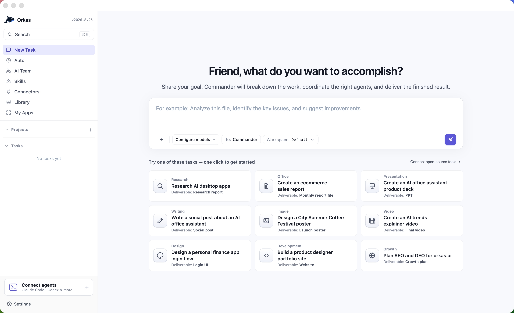

<div align="center">

# OneFleet

**Install an AI bot fleet on your desktop — and command it from WeChat, wherever you are.**

A local-first multi-agent workbench that grows into an IM: one template instantiates a fleet, bots work like employees, and you steer them from your phone.

[](./LICENSE)
[](#quick-start)
[](#why-onefleet)

[English](./README.md) · [简体中文](./README.zh-CN.md)

<!-- TODO: hero screenshot (replace after recording session)
 -->

</div>

## What it does

**One YAML, a fleet in seconds.** Import a fleet template and OneFleet instantiates a team of role-playing bots (researcher, writer, reviewer…) + a group room + the first task. They start working immediately — manage them like employees, not chat windows.

**WeChat is the remote control.** Link your on-duty bot via an official WeChat bot channel (no account-ban risk). Message it from your phone on the commute; the fleet back home gets to work — typing indicator, task progress, and the finished reply, all visible on mobile.

**Employees you can see.** Presence lamps live on bot avatars (idle / working / failed); deliverables land as artifact cards in the thread; a cost milestone card tracks every token the fleet spends.

**Local-first.** Conversations, credentials, and outputs stay on your machine. Bundled runtimes included; you own the model keys.

**Multi-model.** Built-in model catalog, bring-your-own-key: Zhipu GLM · DeepSeek · OpenAI · Anthropic · Kimi · Qwen · Doubao, and more.

## Why OneFleet

Most multi-agent tools grow into "workbenches" or CLIs. OneFleet grows into an **IM** — because the most natural way to direct a team is to talk to it like colleagues. And when the other end of that IM is WeChat, commanding your AI employees is no longer chained to a desk.

- **Fleet-first**: not a pile of chat windows, but an organized team with roles and deliverables
- **WeChat-first**: the most natural remote entry for Chinese users, via the official bot channel — no gray-area protocols
- **Local-first**: your threads, your keys, your outputs — all stay on your machine

## Quick start

### Option A · Download (recommended)

Grab the macOS (Apple Silicon) installer from [Releases](https://github.com/jayswu/OneFleet/releases) and drag it into Applications.

### Option B · Run from source

```bash
git clone https://github.com/jayswu/OneFleet.git && cd OneFleet
npm install
node bin/ensure-runtime.cjs --kind node   # one-time: prepare the bundled Node runtime
export GLM_API_KEY=sk-...                 # model key (Zhipu; other providers supported)
npm start
```

### Link WeChat remote

1. Click the WeChat icon ("Remote") in the left rail
2. Click "Scan to connect WeChat" and scan with WeChat
3. Pick an on-duty bot from the dropdown
4. Message the bot in WeChat — done, it's working for you now

> Model access requires your own API key (data and credentials stay in `~/.onefleet/`). Zhipu GLM is the easiest start — direct connection from mainland China.

## How it works

```
┌─────────────┐   YAML    ┌──────────────────────────────┐
│ Fleet        │ ────────▶ │ Fleet: N role bots + room     │
│ template     │           └──────────┬───────────────────┘
└─────────────┘                      │  Group bus (role routing /
                                     │  admission, plan-first)
 WeChat ◀── iLink official ── Channel┘
 (mobile control)                    │  AgentRunner (multi-model)
                                     ▼
                          Deliverable cards · Cost milestones · Presence lamps
```

- **Group bus**: every conversation (DMs included) runs through one actor-model bus — @mention routing, round caps, plan-first for complex tasks
- **Channel layer**: a thin `ChannelAdapter` abstraction. WeChat (official iLink bot API) is live; Feishu / Telegram are next
- For product decisions and architecture, see [docs/HANDOVER.md](docs/HANDOVER.md)

## Project layout

```
src/main/features/       main-process features (chats · group_chat bus · agents · channels · team_templates)
src/core-agent/          agent kernel (pi-ai based: context budget, memory, skills)
src/renderer/            renderer (IM three-column UI)
docs/HANDOVER.md         product decision log + fresh-machine checklist
docs/research/           market research · competitor evals · design notes
```

## Roadmap

- [ ] Feishu / Telegram channels (abstraction ready)
- [ ] Per-bot cost attribution panel
- [ ] Employee card aggregation (cost / routines / deliverables per bot)
- [ ] Windows / Linux packaging
- [ ] Fleet template marketplace

## Acknowledgements

- [Orkas](https://github.com/Orkas-AI/Orkas) (MIT) — the base this project forks; desktop multi-agent architecture and model layer
- [ZCode](https://github.com/zai-org/ZCode) (Apache 2.0) — protocol reference for the WeChat iLink channel
- [pi](https://github.com/badlogic/pi-mono) — agent kernel foundation

## License

[MIT](./LICENSE) © Orkas contributors · Jayden / OneFleet contributors
