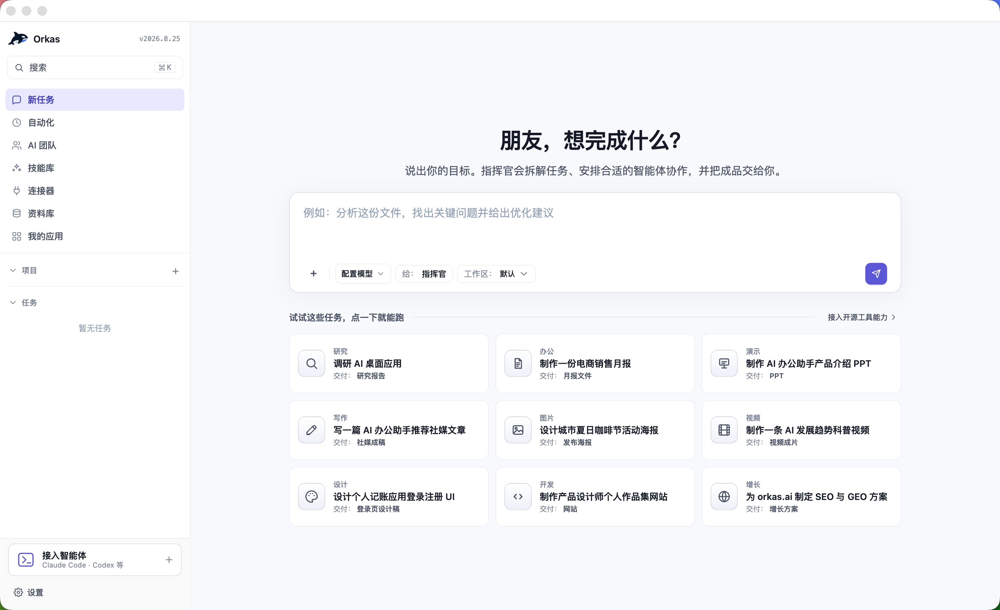

<div align="center">

# OneFleet

**把一支 AI 机器人编队装进你的电脑，再用微信随时随地指挥它。**

本地优先的多 Agent 编队工作台 —— 一份模板三秒建队，机器人像员工一样干活，你在微信里遥控指挥。

[](./LICENSE)
[](#快速开始)
[](#为什么是-onefleet)

[English](./README.md) · [简体中文](./README.zh-CN.md)

<!-- TODO: 主界面截图（录视频素材产出后替换）
 -->

</div>

## 它能做什么

**一份 YAML，三秒建队。** 导入编队模板，自动生成一支角色化的机器人员工队伍（调研员、写手、审查员……）+ 一个群聊房间 + 第一个任务。机器人立刻开工，你像管理员工一样管理它们。

**微信就是遥控器。** 扫码把值班机器人接入微信（微信官方机器人通道，合规无封号风险），通勤路上发一条消息，家里的编队就开始干活——「对方正在输入…」、任务进度、成稿回复，全程手机可见。

**员工可视化。** 状态灯（idle / 工作中 / 出错）直接长在机器人头像上；产出以交付物卡片沉淀在会话里；每支编队消耗多少 token，成本里程碑一目了然。

**本地优先。** 会话、凭据、产出全部存在你自己的电脑上；自带打包好的运行时，模型 key 自己管。

**多模型。** 自带模型目录，BYOK（自带 key）：智谱 GLM · DeepSeek · OpenAI · Anthropic · Kimi · Qwen · Doubao 等。

## 为什么是 OneFleet

多 Agent 协同工具大多长成「工作台」或「命令行」，OneFleet 选择长成 **IM**——因为指挥一支队伍最自然的方式，就是像跟同事聊天一样说话。而当 IM 的另一端接上微信，「指挥 AI 员工」这件事就不再被钉在电脑前。

- **编队优先**：不是一堆聊天窗口，而是有组织、有角色、有交付物的团队
- **微信优先**：国内用户最自然的远程入口，走官方通道，不碰协议灰产
- **本地优先**：你的对话、你的 key、你的产出，都留在你的机器上

## 快速开始

### 方式一 · 下载安装包（推荐）

从 [Releases](https://github.com/jayswu/OneFleet/releases) 下载 macOS (Apple Silicon) 安装包，拖进应用目录即可。

### 方式二 · 源码运行

```bash
git clone https://github.com/jayswu/OneFleet.git && cd OneFleet
npm install
node bin/ensure-runtime.cjs --kind node   # 准备内置 Node 运行时（一次性）
export GLM_API_KEY=sk-...                 # 配置模型 key（智谱；也支持其他供应商）
npm start
```

### 接入微信远程

1. 启动后点左侧微信图标「远程」
2. 点「扫码接入微信」，用微信扫一扫
3. 在「值班机器人」里选一个 bot
4. 在微信里给机器人发消息——完成，它已经能为你干活了

> 模型服务需要自备 API key（数据与凭据只保存在本机 `~/.onefleet/`）。首次使用建议从智谱 GLM 开始，国内直连。

## 它是怎么工作的

```
┌─────────────┐   YAML    ┌──────────────────────────────┐
│ 编队模板     │ ────────▶ │ 编队：N 个角色化机器人 + 群聊  │
└─────────────┘           └──────────┬───────────────────┘
                                     │  群聊总线（角色路由/准入/计划先行）
   微信 ◀── iLink 官方通道 ── 渠道层 ─┤
   （手机遥控）                       │  AgentRunner（多模型）
                                     ▼
                          交付物卡 · 成本里程碑 · 状态灯
```

- **群聊总线**：所有会话（含私聊）统一走 actor 模型总线，@提及解析、轮次上限、计划先行（复杂任务先出计划再执行）
- **渠道层**：`ChannelAdapter` 薄抽象，微信（官方 iLink 机器人 API）已上线，飞书 / Telegram 在路上
- 想深入了解产品决策与架构？见 [docs/HANDOVER.md](docs/HANDOVER.md)

## 项目结构

```
src/main/features/       主进程功能模块（chats · group_chat 总线 · agents · channels · team_templates）
src/core-agent/          agent 内核（pi-ai 体系：上下文预算、记忆、技能）
src/renderer/            渲染层（IM 三栏 UI）
docs/HANDOVER.md         产品决策记录 + 新机启动清单
docs/research/           风口调研 · 竞品实测 · 设计讨论稿
```

## Roadmap

- [ ] 飞书 / Telegram 渠道（渠道抽象已就绪）
- [ ] 成本按机器人归因面板
- [ ] 员工卡片聚合（每机器人的成本 / 例程 / 交付物）
- [ ] Windows / Linux 打包
- [ ] 编队模板市场

## 致谢

- [Orkas](https://github.com/Orkas-AI/Orkas)（MIT）— 本项目的底座，桌面多 Agent 架构与模型接入层来自它
- [ZCode](https://github.com/zai-org/ZCode)（Apache 2.0）— 微信 iLink 通道的协议参考实现
- [pi](https://github.com/badlogic/pi-mono) — agent 内核底座

## License

[MIT](./LICENSE) © Orkas contributors · Jayden / OneFleet contributors
